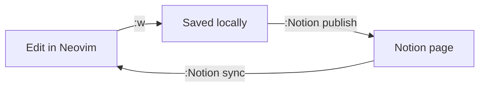
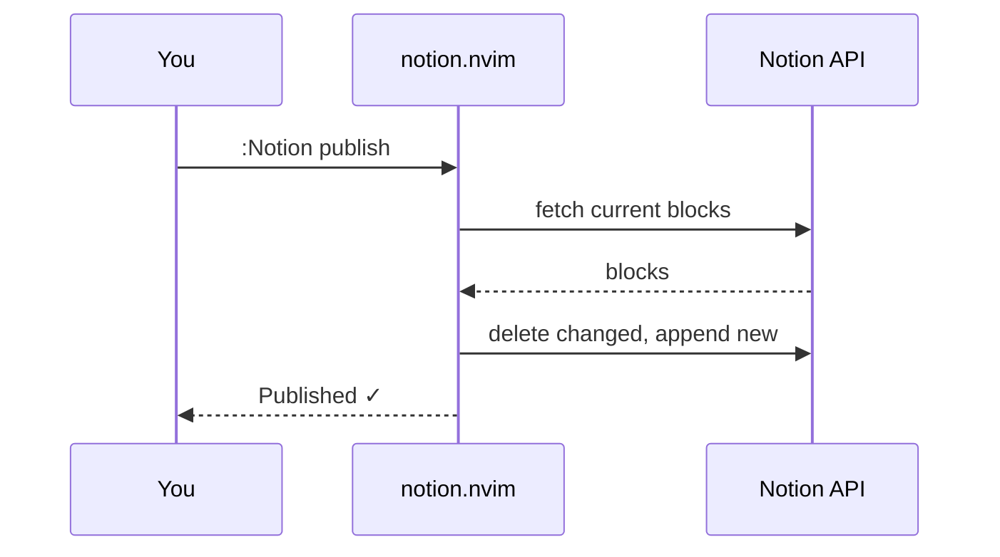

# notion.nvim feature test

This page checks every Markdown feature the plugin maps to Notion. Text can be **bold**, *italic*, ~~struck~~, <u>underlined</u>, `inline code`, **_bold italic_** or a [link](https://neovim.io).

## Lists

- Bullet one
- Bullet two
  - Nested bullet
    - Deeper bullet
- Bullet three

1. First step
2. Second step
   1. Sub-step
3. Third step

- [ ] Open task
- [x] Finished task

## Mermaid diagrams





## Code

```lua
require("notion").setup({
  confirm_publish = true,
})
```

```bash
nvim --headless -u NONE -l tests/run.lua
```

## Quote and callout

> Markdown in Neovim, pages in Notion.
> A second line of the same quote.

> [!NOTE] 💡
> Callouts use GitHub alert syntax.

## Table

| Command | What it does |
| --- | --- |
| `:Notion sync` | Pull changed pages |
| `:Notion publish` | Push this page |

## Math

Inline math: $E = mc^2$.

$$
\int_0^1 x^2 \, dx = \frac{1}{3}
$$

## Toggle

▸ Click to expand
  Hidden details live here.

  - Toggles can hold lists too

## Spacing

Text before two empty blocks.


Text after them.

---


